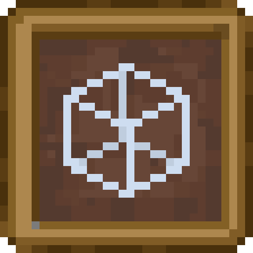

<!-- PROJECT BADGES -->
<div align="center">

[![Packagist][packagist-badge]][packagist-url]
[![CI][ci-badge]][ci-url]
[![Stars][stars-badge]][stars-url]
[![License][license-badge]][license-url]

</div>


<!-- PROJECT LOGO -->
<br />
<div align="center">
  
  <h3>selection-visualize-utils</h3>
  <p align="center">
    Show block selections and fake block previews to players, without touching the world.

[Packagist][packagist-url] · [Changelog](CHANGELOG.md) · [Report a bug][issues-url] · [Request a feature][issues-url]

  </p>
</div>

```php
$selection = new Selection($pos1, $pos2);
$selection->sendTo($player);      // the player sees the bounding box
$selection->restoreFrom($player); // and it is gone again
```

-----

## 🌟 Why selection-visualize-utils?

Region tools, build helpers and placement previews all need to show the player *something* that is not really in the
world. This library does it with packets only (nothing is ever placed on the server):

- **`Selection`** : draws the bounding box of a region with a client-side structure block, like the vanilla
  structure block outline
- **`BlockPreview`** : fakes blocks on the NORMAL layer, with an optional tint on the LIQUID layer, to preview a placement
- **Server world untouched** : only `UpdateBlockPacket` / `BlockActorDataPacket` are sent, and restoring puts the
  real blocks back
- **No leaks** : viewers and slots are tracked in `WeakMap`s, so a `Player` is never kept alive by this library
- **Safe to restore** : nothing is sent to players who disconnected or changed world since
- **No native extension needed** : no `ext-morton` dependency
- **Tested** : run against the real server code on PHP 8.4 / 8.5

## 🎯 Use cases

| You are building...                          | Use                                                    |
|----------------------------------------------|--------------------------------------------------------|
| Region selection (wand) tools                | `Selection`                                            |
| Build helpers that show what will be placed  | `BlockPreview` with a `PreviewEntry` per block         |
| Claim / protection area outlines             | `Selection`, one per viewer                            |
| Highlighting a block position to one player  | `BlockPreview` with a tinted `liquidBlock`             |

-----

## 📦 Installation

```sh
composer require presentkim/selection-visualize-utils
```

| Requirement | Version                                                           |
|-------------|-------------------------------------------------------------------|
| Server      | [axolotl-pm/PocketMine-MP][axolotl-url] (fork of PocketMine-MP 5) |
| PHP         | **8.4** or newer                                                  |

> The Poggit virion for the original PocketMine-MP 5.44 and older is kept on the
> [`legacy/pmmp-5.44`][legacy-url] branch (no longer maintained).

-----

## 🚀 Quick start

All classes are in `kim\present\utils\selectionvisualize`.

### Show a selection

```php
use kim\present\utils\selectionvisualize\Selection;
use pocketmine\math\Vector3;

$selection = new Selection(new Vector3(0, 64, 0), new Vector3(10, 70, 10));
$selection->sendTo($player);

// Later, when you want to remove it:
$selection->restoreFrom($player);
// or for every viewer:
// $selection->restoreFromAll();
```

Moving a corner and calling `sendTo()` again replaces the player's box, so a live "drag to resize" is one line.

### Preview blocks

```php
use kim\present\utils\selectionvisualize\BlockPreview;
use kim\present\utils\selectionvisualize\PreviewEntry;
use pocketmine\block\VanillaBlocks;
use pocketmine\world\Position;

$preview = new BlockPreview($plugin); // the plugin schedules the 1-tick delay

$world = $player->getWorld();
$block = VanillaBlocks::STONE();
$tint  = VanillaBlocks::RED_STAINED_GLASS();

// Stone on the normal layer, tinted glass on the liquid layer
$preview->show($player,
    new PreviewEntry(new Position(0, 64, 0, $world), $block, $tint),
    new PreviewEntry(new Position(1, 64, 0, $world), $block, $tint),
);

// Later:
$preview->clear($player);
```

### Clean up when a player leaves

```php
use kim\present\utils\selectionvisualize\Selection;

public function onQuit(PlayerQuitEvent $event) : void{
    $player = $event->getPlayer();
    Selection::releaseAll($player);  // frees every structure block slot of this player
    $this->preview->clear($player);  // drops a pending or shown preview
}
```

-----

## 📚 Examples

<details open>
<summary><b>Wand tool: two clicks, live box</b></summary>

```php
// $this->selections is a WeakMap<Player, Selection> (or an array you clean up on quit)
public function onInteract(PlayerInteractEvent $event) : void{
    $player = $event->getPlayer();
    $pos = $event->getBlock()->getPosition();
    $selection = $this->selections[$player] ??= new Selection($pos, $pos);

    if($event->getAction() === PlayerInteractEvent::LEFT_CLICK_BLOCK){
        $selection->pos1 = $pos;
    }else{
        $selection->pos2 = $pos;
    }
    $selection->sendTo($player); // replaces the previous box of this player
}
```

</details>

<details>
<summary><b>Preview a fill with the selected block</b></summary>

```php
$entries = [];
$min = $selection->getMin();
$max = $selection->getMax();
for($x = $min->x; $x <= $max->x; ++$x){
    for($y = $min->y; $y <= $max->y; ++$y){
        for($z = $min->z; $z <= $max->z; ++$z){
            $entries[] = new PreviewEntry(new Position($x, $y, $z, $world), $block);
        }
    }
}
$preview->show($player, ...$entries);
```

</details>

<details>
<summary><b>Targeting the preview with an air click</b></summary>

`getPreviewPositions()` returns the `BlockPosition`s currently shown to the player, so you can ray-cast against them
when the player taps the air. See `example/SelectionVisualizeUtilsTest` for a full implementation.

</details>

### Preview

> Below is a test video of the plugin in the `example/SelectionVisualizeUtilsTest`

https://github.com/user-attachments/assets/d53bf2b6-f334-45d9-a5b7-8288c079591f

-----

## 📖 API reference

### `Selection`

| Member                                           | Description                                                                                               |
|--------------------------------------------------|-----------------------------------------------------------------------------------------------------------|
| `new Selection(Vector3 $pos1, Vector3 $pos2)`    | Two corners of an axis-aligned region. `pos1` and `pos2` are public and can be changed                   |
| `getMin() : Vector3` / `getMax() : Vector3`      | Lowest / highest block coordinates (fractional coordinates are floored)                                  |
| `sendTo(Player $player) : void`                  | Show the box. One per player per `Selection`: sending again restores the previous one first. Throws `RuntimeException` if the column has no free Y slot |
| `restoreFrom(Player $player) : void`             | Remove the box and free the slot. Packets are only sent if the player is connected and still in the world the box was sent in |
| `restoreFromAll() : void`                        | `restoreFrom()` for every viewer                                                                         |
| `forget(Player $player) : void`                  | Stop tracking the player and free the slot **without sending packets**                                   |
| `hasViewer(Player $player) : bool`               | Whether the selection is currently shown to the player                                                   |
| `static releaseAll(Player $player) : void`       | Free every slot of the player across all selections, no packets. Call it on `PlayerQuitEvent`            |

### `BlockPreview`

| Member                                                   | Description                                                                                          |
|----------------------------------------------------------|------------------------------------------------------------------------------------------------------|
| `new BlockPreview(PluginBase $plugin)`                   | The plugin is used to schedule the delayed task                                                      |
| `show(Player $player, PreviewEntry ...$entries) : void`  | Clear the previous preview and show the entries one tick later. Entries in another world than the player's are skipped |
| `clear(Player $player) : void`                           | Cancel a pending preview and restore the real blocks (and the liquid layer, if one was sent)         |
| `getPreviewPositions(Player $player) : BlockPosition[]`  | Positions of the preview currently shown to the player                                               |

### `PreviewEntry`

| Property                       | Description                                                                   |
|--------------------------------|-------------------------------------------------------------------------------|
| `Position $position`           | Where the preview is shown                                                    |
| `Block $block`                 | Block faked on the NORMAL layer                                               |
| `?Block $liquidBlock = null`   | Block faked on the LIQUID layer. When `null`, no liquid layer is sent         |

### Behavior notes

- **Slots** : each box needs a structure block position of its own in the player's view. Slots are allocated per player,
  per world and per (x, z) column, from the lowest Y up, and freed on `restoreFrom()` / `forget()` / `releaseAll()`.
- **Weak references** : players and worlds are held in `WeakMap` / `WeakReference`. A player that leaves without
  `restoreFrom()` is freed when its object is garbage collected, but calling `releaseAll()` on quit frees it right away.
- **World changes** : `restoreFrom()` and `clear()` send nothing if the player is no longer in the world the packets
  were sent in; only the bookkeeping is dropped.
- **Delayed preview** : `show()` sends one tick later so the server's own block resync (after a click) cannot overwrite
  the fake blocks. `clear()` before that tick cancels the preview.

> **Large selections** : the size is sent as is, and the Bedrock client limits the bounding box of a structure block.
> Very large selections may not be drawn completely.

-----

## 🧪 Development

```sh
composer install --ignore-platform-req='ext-*'
composer test
```

The tests run against the real `axolotl-pm/pocketmine-mp` code without its native extensions.
`example/SelectionVisualizeUtilsTest` is a small test plugin (`/selectionvisualize`, alias `/svu`) that combines a
selection with a block preview.

-----

## 📄 License

Distributed under the **MIT** License. See [LICENSE][license-url] for more information.


[packagist-badge]: https://img.shields.io/packagist/v/presentkim/selection-visualize-utils.svg?style=for-the-badge

[packagist-url]: https://packagist.org/packages/presentkim/selection-visualize-utils

[ci-badge]: https://img.shields.io/github/actions/workflow/status/presentkim-pm/selection-visualize-utils/ci.yml?branch=main&style=for-the-badge

[ci-url]: https://github.com/presentkim-pm/selection-visualize-utils/actions/workflows/ci.yml

[stars-badge]: https://img.shields.io/github/stars/presentkim-pm/selection-visualize-utils.svg?style=for-the-badge

[stars-url]: https://github.com/presentkim-pm/selection-visualize-utils/stargazers

[license-badge]: https://img.shields.io/github/license/presentkim-pm/selection-visualize-utils.svg?style=for-the-badge

[license-url]: https://github.com/presentkim-pm/selection-visualize-utils/blob/main/LICENSE

[issues-url]: https://github.com/presentkim-pm/selection-visualize-utils/issues

[legacy-url]: https://github.com/presentkim-pm/selection-visualize-utils/tree/legacy/pmmp-5.44

[axolotl-url]: https://github.com/axolotl-pm/PocketMine-MP
